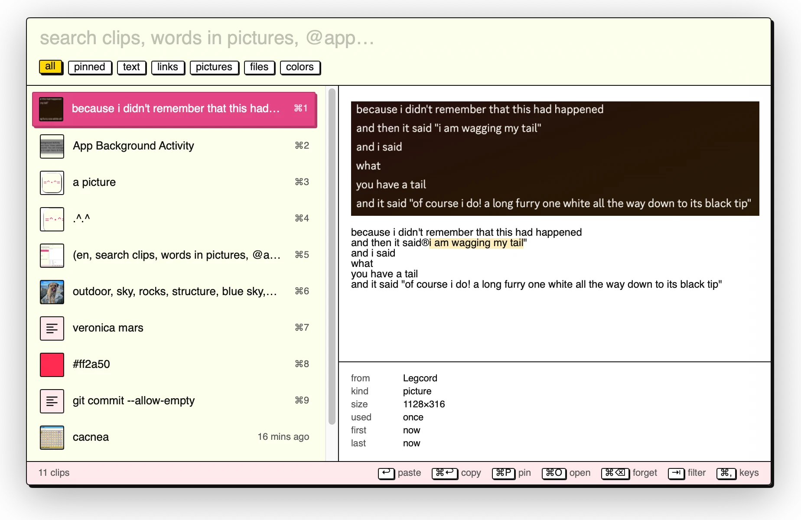

# clip cat

macos app

- overlay cute fast, cute, clipboard manager with history searchable images ⌃⌘C
- overlay cute fast, cute  emoji search filter ⌃⌘E
- =^.^=

## keys

- ⌃⌘C  clipboard manager
- ⌃⌘E  emoji
- ⌘,  (with either open) change keybindings
